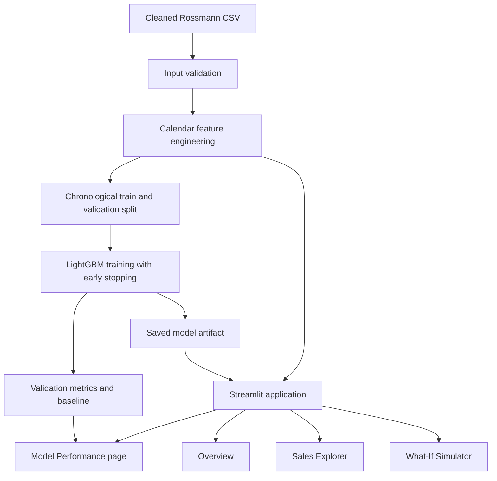

# Project Architecture

## End-to-end flow



## Main modules

| Path | Responsibility |
|---|---|
| `Data/Cleaned/store_sales_cleaned.csv` | Cleaned store-day source data |
| `src/features/build_features.py` | Date handling, calendar history, lag/rolling features, and feature validation |
| `src/modeling/train_lightgbm.py` | Input checks, chronological split, model training, evaluation, and artifact saving |
| `app/app.py` | Streamlit interface, model loading, predictions, and What-If scenarios |
| `tests/test_features.py` | Unit tests for calendar lags, leakage prevention, and invalid inputs |
| `artifacts/model/` | Local model, metrics, feature importance, and validation predictions |

## Training outputs

After training, the following files are generated locally:

- `lightgbm_sales_model.joblib`: fitted model.
- `metrics.json`: evaluation metrics and validation metadata.
- `feature_importance.csv`: model feature importance values.
- `validation_predictions.csv`: actual and predicted values for validation rows.

These are generated artifacts and should not be committed by default. The model can be recreated from the source code and cleaned dataset.

## Reproducibility

Run commands from the repository root:

```powershell
python -m pytest -q
python src/modeling/train_lightgbm.py --n-estimators 300
python src/modeling/train_lightgbm.py
streamlit run app/app.py
```

The 300-estimator command is a first smoke test. The default training run uses up to 1,200 estimators with early stopping.

## Validation boundaries

The training split is chronological. Validation is rolling one-day-ahead: earlier actual validation-day sales may become lag inputs for subsequent validation dates. Do not describe it as a fixed-origin 42-day-ahead forecast.

The data is open-positive-only, and missing dates inside a store's observed span are treated as zero-sales history. Refer to the model card for the implications.
